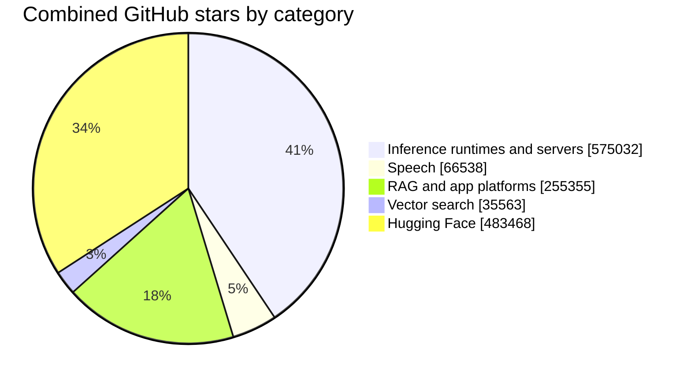

# Awesome Craft AI 

> A curated list of open-source, self-hostable AI runtimes, servers, Hugging Face libraries and related infrastructure.

A runtime or API shape is not the same thing as a hosted SaaS product. These tools can expose interfaces that look similar to vendor APIs, but they do not reproduce a provider's models, moderation, tooling or terms. Tool licences and model licences are separate: permission to run a server does not grant commercial use of a given weight file. Chat apps, coding agents, workflow tools and image UIs are listed in Awesome Craft Agents to avoid duplicating this list. Official Hugging Face libraries, servers, JavaScript clients and courses are in the Hugging Face section; Text Generation Inference stays under inference runtimes.

## Contents

- [Dashboard](#dashboard)
- [Inference runtimes and servers](#inference-runtimes-and-servers)
- [Speech](#speech)
- [RAG and app platforms](#rag-and-app-platforms)
- [Vector search](#vector-search)
- [Hugging Face](#hugging-face)
- [Related lists](#related-lists)
- [Star history](#star-history)

## Dashboard

<table>
<tr>
<td align="center"><h2>35</h2>listed projects</td>
<td align="center"><h2>5</h2>categories</td>
<td align="center"><h2>1.42M</h2>combined GitHub stars</td>
<td align="center"><h2>215.1k</h2>combined forks</td>
<td align="center"><h2>33/35</h2>pushed in the last 30 days</td>
<td align="center"><h2>8</h2>languages</td>
</tr>
</table>

**FACT** (snapshot taken 2026-11-15, GitHub API): 35 listed projects, 35 of them on GitHub with public repository statistics. Official documentation and other non-GitHub entries are listed but have no stars, forks or push dates.

**ESTIMATE**: 1.42M combined GitHub stars and 215.1k combined forks, summed from those API counts on the snapshot date. Live star badges next to GitHub entries may differ.

### 🏆 Leaderboard

<table>
<tr><th>Rank</th><th>Project</th><th>Kind</th><th align="right">Stars</th><th></th></tr>
<tr><td align="center">🥇</td><td><b>Ollama</b></td><td>Local model runner</td><td align="right">187.0k</td><td><code>████████████████████</code></td></tr>
<tr><td align="center">🥈</td><td><b>Transformers</b></td><td>Model library</td><td align="right">169.0k</td><td><code>██████████████████</code></td></tr>
<tr><td align="center">🥉</td><td><b>Dify</b></td><td>LLM app platform</td><td align="right">161.2k</td><td><code>█████████████████</code></td></tr>
<tr><td align="center">4</td><td><b>llama.cpp</b></td><td>Inference engine</td><td align="right">135.1k</td><td><code>██████████████</code></td></tr>
<tr><td align="center">5</td><td><b>vLLM</b></td><td>GPU serving</td><td align="right">96.9k</td><td><code>██████████</code></td></tr>
<tr><td align="center">6</td><td><b>RAGFlow</b></td><td>RAG platform</td><td align="right">94.2k</td><td><code>██████████</code></td></tr>
<tr><td align="center">7</td><td><b>whisper.cpp</b></td><td>Speech recognition</td><td align="right">55.2k</td><td><code>██████</code></td></tr>
<tr><td align="center">8</td><td><b>LocalAI</b></td><td>API gateway</td><td align="right">50.4k</td><td><code>█████</code></td></tr>
<tr><td align="center">9</td><td><b>Gradio</b></td><td>App toolkit</td><td align="right">44.1k</td><td><code>█████</code></td></tr>
<tr><td align="center">10</td><td><b>SGLang</b></td><td>GPU serving</td><td align="right">38.9k</td><td><code>████</code></td></tr>
</table>

### Stars by category

### Licences

  

"Custom" or "None" means GitHub could not match a standard SPDX licence, often because of extra terms or an undeclared licence. Read the project licence before you use it commercially.

## Inference runtimes and servers

- [llama.cpp](https://github.com/ggml-org/llama.cpp) - A C and C++ engine for running GGUF language models on CPU, Metal, CUDA, Vulkan and other backends, with a command-line interface and an HTTP server. 
- [llamafile](https://github.com/mozilla-ai/llamafile) - Packs a llama.cpp runtime and a model into a single executable. Confirm the licence of any bundled model separately. 
- [LocalAI](https://github.com/mudler/LocalAI) - A self-hosted, OpenAI-compatible API gateway that can sit in front of several model backends. Compatibility is at the API-shape level and depends on the backend you configure. 
- [MLX](https://github.com/ml-explore/mlx) - Apple's array framework for machine learning on Apple silicon, often used with mlx-lm to run language models locally on Macs. This is an Apple-silicon toolkit, not a cross-vendor serving stack. 
- [Ollama](https://github.com/ollama/ollama) - A local model runner and model library with a CLI and an HTTP API, including OpenAI-compatible endpoints. The ollama/ollama repository is MIT; confirm the licence of any separately distributed desktop application. 
- [SGLang](https://github.com/sgl-project/sglang) - A serving engine aimed at structured output and efficient multi-turn workloads, in the same broad class as vLLM. 
- [Text Generation Inference](https://github.com/huggingface/text-generation-inference) - Hugging Face's model-serving server. It was distributed under a more restrictive licence for a period beginning in 2023 and later returned to Apache-2.0; confirm the tag you deploy The GitHub repository is archived in this snapshot.. 
- [vLLM](https://github.com/vllm-project/vllm) - A high-throughput GPU inference and serving engine with an OpenAI-compatible server, using techniques such as paged attention and continuous batching. 

## Speech

- [Piper](https://github.com/rhasspy/piper) - A local neural text-to-speech system designed for offline and embedded use. Voice packs have their own licences The GitHub repository is archived in this snapshot.. 
- [whisper.cpp](https://github.com/ggml-org/whisper.cpp) - A C and C++ port of OpenAI Whisper models for local transcription. The original Whisper model terms are separate from this runtime. 

## RAG and app platforms

- [Dify](https://github.com/langgenius/dify) - A self-hostable LLM application platform. The repository uses a modified Apache-2.0 licence: operating a multi-tenant service requires a commercial licence from the producer, and the frontend logo may not be removed. Treat this as source-available with extra conditions. 
- [RAGFlow](https://github.com/infiniflow/ragflow) - A self-hostable retrieval-augmented generation engine and UI for building document-aware assistants. 

## Vector search

- [Qdrant](https://github.com/qdrant/qdrant) - A vector database you can self-host for embeddings and similarity search. This is infrastructure for RAG and related apps, not a complete chat product. 

## Hugging Face

- [Accelerate](https://github.com/huggingface/accelerate) - A library for launching and training PyTorch models on one or many devices, with mixed precision and distributed backends. 
- [Agents Course](https://github.com/huggingface/agents-course) - Hugging Face's free course on building agents, with notebooks and materials. 
- [Candle](https://github.com/huggingface/candle) - A minimalist machine learning framework written in Rust. 
- [Chat UI](https://github.com/huggingface/chat-ui) - The open-source web UI that powers HuggingChat, which you can self-host. 
- [Datasets](https://github.com/huggingface/datasets) - A library for loading, processing and sharing machine learning datasets from the Hugging Face Hub. 
- [Datatrove](https://github.com/huggingface/datatrove) - A library of reusable pipeline blocks for large-scale dataset processing. 
- [Diffusers](https://github.com/huggingface/diffusers) - A library of state-of-the-art diffusion models for image, video and audio generation in PyTorch. Model licences are separate from the library. 
- [Gradio](https://github.com/gradio-app/gradio) - A Python library for building machine learning web apps and demos. The repository is maintained under the gradio-app organisation. 
- [Hugging Face Course](https://github.com/huggingface/course) - The official Hugging Face course on Transformers and the Hub. 
- [Hugging Face Hub](https://github.com/huggingface/huggingface_hub) - The official Python client and CLI for the Hugging Face Hub. 
- [Hugging Face.js](https://github.com/huggingface/huggingface.js) - Official JavaScript and TypeScript clients for the Hugging Face Hub and inference APIs. 
- [LightEval](https://github.com/huggingface/lighteval) - A toolkit for evaluating language models across multiple backends. 
- [Optimum](https://github.com/huggingface/optimum) - Hardware-acceleration tooling for Transformers, Diffusers and related libraries, including ONNX Runtime and Intel backends. 
- [PEFT](https://github.com/huggingface/peft) - Parameter-efficient fine-tuning methods such as LoRA for Transformers and diffusion models. 
- [Safetensors](https://github.com/safetensors/safetensors) - A simple, safer format and library for storing tensors, from Hugging Face. The repository moved to safetensors/safetensors. 
- [Smol Course](https://github.com/huggingface/smol-course) - A course on aligning and fine-tuning small language models. 
- [Smolagents](https://github.com/huggingface/smolagents) - A small library for building agents that write and run code as their actions. 
- [Text Embeddings Inference](https://github.com/huggingface/text-embeddings-inference) - A high-performance server for text embedding models, from Hugging Face. 
- [Tokenizers](https://github.com/huggingface/tokenizers) - Fast tokenizers, implemented in Rust with Python bindings, used by Transformers. 
- [Transformers](https://github.com/huggingface/transformers) - The model-definition library for thousands of pretrained text, vision, audio and multimodal models. Model licences are separate from the library. 
- [Transformers.js](https://github.com/huggingface/transformers.js) - Run Hugging Face Transformers models directly in the browser or in Node.js, with no Python server. 
- [TRL](https://github.com/huggingface/trl) - Train transformer language models with reinforcement learning and related post-training methods. 

## Related lists

Other lists in the Awesome Craft series:

- [Awesome Craft](https://github.com/EdisonTKPcom/Awesome-Craft) - A curated list of open-source, self-hostable alternatives to popular SaaS tools.
- [Awesome Craft Agents](https://github.com/EdisonTKPcom/Awesome-Craft-Agents) - A curated list of open-source chat apps, coding agents, self-hosted agent bots, workflow automation and image-generation UIs.
- [Awesome Craft BSC](https://github.com/EdisonTKPcom/Awesome-Craft-BSC) - A curated list of verified open-source clients, SDKs, dev tools and protocol code for BNB Smart Chain and opBNB.
- [Awesome Craft CUDA](https://github.com/EdisonTKPcom/Awesome-Craft-CUDA) - A curated list of open-source CUDA learning material, kernel libraries, tooling and portability projects.
- [Awesome Craft DeepSeek](https://github.com/EdisonTKPcom/Awesome-Craft-DeepSeek) - A curated list of official DeepSeek repositories and open-source harnesses, serving engines, eval tools and fine-tuning stacks that work with DeepSeek models.
- [Awesome Craft DevOps](https://github.com/EdisonTKPcom/Awesome-Craft-DevOps) - A curated list of open-source, self-hostable alternatives to popular DevOps and hosting SaaS tools.
- [Awesome Craft Ethereum](https://github.com/EdisonTKPcom/Awesome-Craft-Ethereum) - A curated list of verified open-source Ethereum clients, SDKs, dev frameworks, wallets and security tools.
- [Awesome Craft EV](https://github.com/EdisonTKPcom/Awesome-Craft-EV) - A curated list of open-source software and hardware for electric vehicles and charging.
- [Awesome Craft Hardware](https://github.com/EdisonTKPcom/Awesome-Craft-Hardware) - A curated list of open-source tools for PCB, FPGA, ASIC and chip design.
- [Awesome Craft Hyperliquid](https://github.com/EdisonTKPcom/Awesome-Craft-Hyperliquid) - A curated list of verified open-source SDKs, node tools, analytics and community libraries for the Hyperliquid ecosystem.
- [Awesome Craft Malaysia](https://github.com/EdisonTKPcom/Awesome-Craft-Malaysia) - A curated list of open-source tools useful to Malaysian SMEs, with verified MyInvois support called out separately.
- [Awesome Craft Solana](https://github.com/EdisonTKPcom/Awesome-Craft-Solana) - A curated list of verified open-source Solana clients, SDKs, frameworks, explorers and program libraries.
- [Awesome Craft Web3](https://github.com/EdisonTKPcom/Awesome-Craft-Web3) - A curated list of open-source DEX protocol code, self-custody software, indexers, frameworks and Blockchain infrastructure.

## Star history

## Contributing

Contributions welcome! Read the [contribution guidelines](contributing.md) first.

If this list is useful, give it a ⭐ so others can find it.

