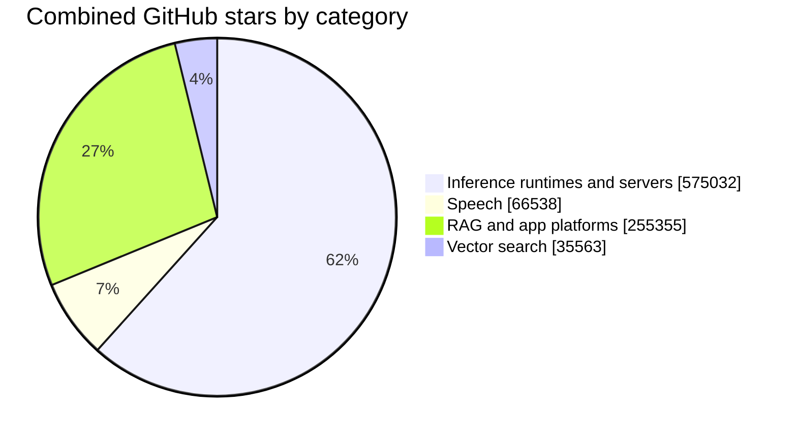

# Awesome Craft AI 

> A curated list of open-source, self-hostable AI runtimes, servers and related infrastructure.

A runtime or API shape is not the same thing as a hosted SaaS product. These tools can expose interfaces that look similar to vendor APIs, but they do not reproduce a provider's models, moderation, tooling or terms. Tool licences and model licences are separate: permission to run a server does not grant commercial use of a given weight file. Chat apps, coding agents, workflow tools and image UIs are listed in Awesome Craft Agents to avoid duplicating this list.

Related lists: [Awesome Craft](https://github.com/EdisonTKPcom/Awesome-Craft), [Awesome Craft Agents](https://github.com/EdisonTKPcom/Awesome-Craft-Agents), [Awesome Craft DeepSeek](https://github.com/EdisonTKPcom/Awesome-Craft-DeepSeek).

## Contents

- [Dashboard](#dashboard)
- [Inference runtimes and servers](#inference-runtimes-and-servers)
- [Speech](#speech)
- [RAG and app platforms](#rag-and-app-platforms)
- [Vector search](#vector-search)

## Dashboard

<table>
<tr>
<td align="center"><h2>13</h2>listed projects</td>
<td align="center"><h2>4</h2>categories</td>
<td align="center"><h2>932.5k</h2>combined GitHub stars</td>
<td align="center"><h2>137.1k</h2>combined forks</td>
<td align="center"><h2>11/13</h2>pushed in the last 30 days</td>
<td align="center"><h2>4</h2>languages</td>
</tr>
</table>

Stats snapshot taken on 2026-11-15 from the GitHub API, for GitHub-hosted repositories only. Official documentation and other non-GitHub entries are listed but have no stars, forks or push dates. Star badges next to GitHub entries update live.

### 🏆 Leaderboard

<table>
<tr><th>Rank</th><th>Project</th><th>Kind</th><th align="right">Stars</th><th></th></tr>
<tr><td align="center">🥇</td><td><b>Ollama</b></td><td>Local model runner</td><td align="right">187.0k</td><td><code>████████████████████</code></td></tr>
<tr><td align="center">🥈</td><td><b>Dify</b></td><td>LLM app platform</td><td align="right">161.2k</td><td><code>█████████████████</code></td></tr>
<tr><td align="center">🥉</td><td><b>llama.cpp</b></td><td>Inference engine</td><td align="right">135.1k</td><td><code>██████████████</code></td></tr>
<tr><td align="center">4</td><td><b>vLLM</b></td><td>GPU serving</td><td align="right">96.9k</td><td><code>██████████</code></td></tr>
<tr><td align="center">5</td><td><b>RAGFlow</b></td><td>RAG platform</td><td align="right">94.2k</td><td><code>██████████</code></td></tr>
<tr><td align="center">6</td><td><b>whisper.cpp</b></td><td>Speech recognition</td><td align="right">55.2k</td><td><code>██████</code></td></tr>
<tr><td align="center">7</td><td><b>LocalAI</b></td><td>API gateway</td><td align="right">50.4k</td><td><code>█████</code></td></tr>
<tr><td align="center">8</td><td><b>SGLang</b></td><td>GPU serving</td><td align="right">38.9k</td><td><code>████</code></td></tr>
<tr><td align="center">9</td><td><b>Qdrant</b></td><td>Vector database</td><td align="right">35.6k</td><td><code>████</code></td></tr>
<tr><td align="center">10</td><td><b>MLX</b></td><td>Apple silicon ML</td><td align="right">29.2k</td><td><code>███</code></td></tr>
</table>

### Stars by category

### Licences

  

"Custom" or "None" means GitHub could not match a standard SPDX licence, often because of extra terms or an undeclared licence. Read the project licence before you use it commercially.

## Inference runtimes and servers

- [llama.cpp](https://github.com/ggml-org/llama.cpp) - A C and C++ engine for running GGUF language models on CPU, Metal, CUDA, Vulkan and other backends, with a command-line interface and an HTTP server. 
- [llamafile](https://github.com/mozilla-ai/llamafile) - Packs a llama.cpp runtime and a model into a single executable. Confirm the licence of any bundled model separately. 
- [LocalAI](https://github.com/mudler/LocalAI) - A self-hosted, OpenAI-compatible API gateway that can sit in front of several model backends. Compatibility is at the API-shape level and depends on the backend you configure. 
- [MLX](https://github.com/ml-explore/mlx) - Apple's array framework for machine learning on Apple silicon, often used with mlx-lm to run language models locally on Macs. This is an Apple-silicon toolkit, not a cross-vendor serving stack. 
- [Ollama](https://github.com/ollama/ollama) - A local model runner and model library with a CLI and an HTTP API, including OpenAI-compatible endpoints. The ollama/ollama repository is MIT; confirm the licence of any separately distributed desktop application. 
- [SGLang](https://github.com/sgl-project/sglang) - A serving engine aimed at structured output and efficient multi-turn workloads, in the same broad class as vLLM. 
- [Text Generation Inference](https://github.com/huggingface/text-generation-inference) - Hugging Face's model-serving server. It was distributed under a more restrictive licence for a period beginning in 2023 and later returned to Apache-2.0; confirm the tag you deploy The GitHub repository is archived in this snapshot.. 
- [vLLM](https://github.com/vllm-project/vllm) - A high-throughput GPU inference and serving engine with an OpenAI-compatible server, using techniques such as paged attention and continuous batching. 

## Speech

- [Piper](https://github.com/rhasspy/piper) - A local neural text-to-speech system designed for offline and embedded use. Voice packs have their own licences The GitHub repository is archived in this snapshot.. 
- [whisper.cpp](https://github.com/ggml-org/whisper.cpp) - A C and C++ port of OpenAI Whisper models for local transcription. The original Whisper model terms are separate from this runtime. 

## RAG and app platforms

- [Dify](https://github.com/langgenius/dify) - A self-hostable LLM application platform. The repository uses a modified Apache-2.0 licence: operating a multi-tenant service requires a commercial licence from the producer, and the frontend logo may not be removed. Treat this as source-available with extra conditions. 
- [RAGFlow](https://github.com/infiniflow/ragflow) - A self-hostable retrieval-augmented generation engine and UI for building document-aware assistants. 

## Vector search

- [Qdrant](https://github.com/qdrant/qdrant) - A vector database you can self-host for embeddings and similarity search. This is infrastructure for RAG and related apps, not a complete chat product. 

## Contributing

Contributions welcome! Read the [contribution guidelines](contributing.md) first.

If this list is useful, give it a ⭐ so others can find it.

